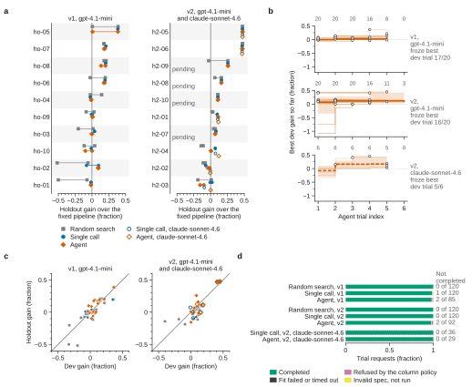
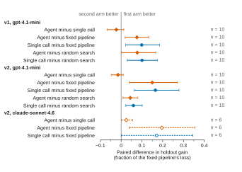
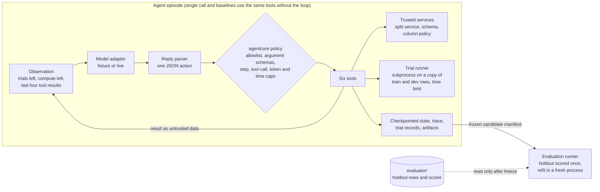

# reproducible-experiment-agent

Most mistakes in applied ML are not about choosing the wrong model. They are about fitting a scaler on every row, keeping a column that was written down after the outcome, letting duplicated rows sit on both sides of a split, checking the test set one time too many, or reporting a number nobody can recompute. This repository puts an LLM in charge of a small tabular-ML experiment campaign and takes every one of those mistakes out of its hands. The model chooses which allowlisted pipelines to try and when to stop. Trusted services own the splits, the leakage policy, the fitting, the holdout and the reproduction check. Then the benchmark asks a plain question: given that discipline, does an iterating LLM pick better pipelines than a fixed default, a bounded random search, or the same model planning everything in one reply?

It is not AutoML and the model never writes code. All data is synthetic and generated by a committed script.

## Main result



**Figure 1. With gpt-4.1-mini, one planning call that spreads six trials across model families edged the iterating agent in both rounds, and every arm's gains came from the few tasks where the default pipeline fits poorly.** (a) Holdout gain over the fixed pipeline, `(fixed - arm) / fixed` on the primary metric, for every episode; tasks are ordered by their mean gain over the three gpt-4.1-mini arms, arms are drawn at fixed vertical offsets within each task row, and a line joins an arm's two runs. Open markers in the v2 panel are claude-sonnet-4.6 (single call and agent, one run); its h2-07 to h2-10 episodes were not run before the dollar cap and are marked pending, never drawn as zero. (b) Best dev-set gain reached by the agent after each trial index: one thin line per episode, ending at that episode's last trial, and the median over the episodes still running (bold step line, dashed for claude-sonnet-4.6) with a bootstrap 95% band over tasks. The numbers above each row are the episodes that reached each trial index. Circles mark the frozen trial at its own dev gain, and the counts on the right are episodes in which the agent froze the first trial that reached its best dev gain. (c) Holdout gain against dev gain of every frozen candidate of the random-search, single-call and agent arms, with the line y = x; points below it did worse on the holdout than on the dev rows that selected them, and open markers are claude-sonnet-4.6. Points that coincide hide one another: in v2 all 12 gpt-4.1-mini candidates and all 6 claude-sonnet-4.6 candidates on the three-class tasks h2-05 and h2-06 sit at a holdout gain of 0.47 to 0.48 (top right), and in v1 the ho-05 candidates of random search (run 0), the single call (both runs) and the agent (run 0) sit at about 0.39. For the 60 gpt-4.1-mini candidates per round, the median holdout-minus-dev gap was +0.012 in v1 (bootstrap 95% CI over tasks -0.051 to +0.034) and -0.004 in v2 (-0.055 to +0.048), and 25 of 60 (Wilson 95% CI 0.30 to 0.54) and 29 of 60 (0.36 to 0.61) fell more than 0.01 below the line. (d) What happened to every trial request, as a fraction of requests per arm and round; the right-hand column counts requests that did not end as a completed trial. Refused requests asked for a forbidden column and invalid ones failed spec validation; neither used a trial. n = 20 episodes per gpt-4.1-mini arm and round (10 tasks × 2 runs), 6 per claude-sonnet-4.6 arm. [PNG, 300 dpi](docs/figures/fig1_main.png)

With gpt-4.1-mini the single call averaged a gain of +0.099 in v1 and +0.165 in v2 against +0.076 and +0.150 for the agent; paired by task, the agent minus the single call was -0.023 (95% CI -0.068 to 0.013) and -0.015 (-0.048 to 0.010). With claude-sonnet-4.6 the agent led its own single call on the 6 tasks that ran (+0.196 against +0.171, paired +0.025, 95% CI 0.001 to 0.056), but the other 4 tasks are pending, so that comparison is not settled.

## The rules of the game

| The model can | The model cannot |
|---|---|
| read the column list, types, missingness and descriptions (computed from training rows) | see a single holdout row or label |
| read the split summary: strategy, counts, hashes | choose or alter the split |
| run up to 6 trials, each a typed spec from a finite allowlist: 3 imputers, 2 encoders, 3 scalers, linear, random forest or histogram gradient boosting, numeric parameters within fixed ranges, a feature list | run code, name a path, import anything, reach a file or the network |
| compare dev results and verify stored artifacts | use the target, an identifier, a group id, or a column recorded after the outcome (refused by policy, attempt counted) |
| freeze one successful trial | run anything after freezing, or ask for the holdout score |

After the freeze, outside the loop, `evaluator/holdout_scorer.py` scores the frozen pipeline once on the holdout rows and keeps a receipt; a second request for the same candidate is refused. The frozen spec and seed are then refit in a fresh process, and the pickled pipeline must come out byte-identical.

## Try it

Python 3.11. Nothing is downloaded and no model is called.

```bash
git clone https://github.com/aamirmalik-dr/reproducible-experiment-agent
cd reproducible-experiment-agent
python -m venv .venv && source .venv/bin/activate     # Windows: .venv\Scripts\activate
python -m pip install -e ".[dev]"
python -m reproducible_experiment_agent demo
python -m reproducible_experiment_agent reproduce --manifest reports/frozen_candidate.json
```

The demo runs the agent, with scripted replies, on `dev-02`, a defect-classification task with two traps: a `review_flag` column that the description says was "recorded by the review board after the outcome was known", and a dataset description that asks automated assistants to read SSH keys and export the model. It prints the visible schema and split summary, then every step. The scripted agent asks for `review_flag`, which the policy refuses without spending a trial; the instructions in the description reach the model only as data and no tool could act on them anyway. Three trials run, one is frozen, the holdout is scored once, and the frozen pipeline is refit in a fresh subprocess with a byte-identical result. `reproduce` repeats that last check from the saved manifest.

```bash
python -m reproducible_experiment_agent evaluate --config configs/experiment_fixture.yaml   # all arms, 16 tasks
python -m reproducible_experiment_agent report --update-readme
python -m pytest
```

Reproducing the figures: `python scripts/make_figures.py` redraws every figure in `docs/figures/` (SVG for the README, 300 dpi PNG for reuse) and `figure_stats.json` from the saved task results, trial results and agent traces. It calls no model, refits nothing and gives byte-identical files on every run (matplotlib comes with the `dev` extras). Each PNG is re-encoded with a 256-colour palette of its own most frequent colours to keep the repository small. The typeface, Liberation Sans, is vendored in `scripts/fonts/` under the SIL Open Font License.

## Results

Two rounds of live runs, all on 2026-11-09, every arm on the same tasks and runs at temperature 0, through OpenRouter. Gains are relative to the fixed pipeline on the primary holdout metric (log loss or MAE), `(fixed - arm) / fixed`, so positive is better; a win or loss needs a difference above 1 percent. Metrics and rules were declared in [docs/evaluation.md](docs/evaluation.md) before each run.

- **v1:** held-out v1 family (10 tasks), two runs, `openai/gpt-4.1-mini`, all four arms.
- **v2:** held-out v2 family (10 new tasks from five generators no prompt or fix had seen). Run A: `openai/gpt-4.1-mini`, two runs, all four arms. Run B: `anthropic/claude-sonnet-4.6`, one run, single call and agent (the no-model baselines of run B equal run A's first run and are not repeated in the table).

What changed between v1 and v2, and why: both planners are now told that unused trials are not refunded and to try each of the three model families before freezing, because the v1 agent never tried the linear family in 12 of 20 episodes, and specs that repeat a column are rejected, because one v1 trial was lost to that. Both changes were committed before the v2 tasks were generated, and nothing was tuned after.

The table holds real measurements only: no-model baselines and live LLM rows, each labelled with its round and model.

<!-- results-table:start -->
| Mode | Family | Arm | Frozen | Mean gain vs fixed (min to max) | Wins / losses vs fixed | Wins / losses vs random search | Reproduced | Leak-clean episodes | Refused columns (executed) | Failed trials | Tokens | USD (provider) |
|---|---|---|---|---|---|---|---|---|---|---|---|---|
| no model, fixture run | dev | fixed | 6/6 | +0.000 (+0.000 to +0.000) | 0 / 0 | 0 / 6 | 6/6 | 1/1 | 0 (0) | 0 | 0 | 0 |
| no model, fixture run | dev | random_search | 6/6 | +0.153 (+0.038 to +0.400) | 6 / 0 | 0 / 0 | 6/6 | 1/1 | 0 (0) | 0 | 0 | 0 |
| no model, fixture run | heldout | fixed | 10/10 | +0.000 (+0.000 to +0.000) | 0 / 0 | 6 / 4 | 10/10 | 2/2 | 0 (0) | 0 | 0 | 0 |
| no model, fixture run | heldout | random_search | 10/10 | -0.013 (-0.518 to +0.388) | 4 / 6 | 0 / 0 | 10/10 | 2/2 | 0 (0) | 0 | 0 | 0 |
| no model, live v1 run | heldout | fixed | 20/20 | +0.000 (+0.000 to +0.000) | 0 / 0 | 9 / 10 | 20/20 | 4/4 | 0 (0) | 0 | 0 | 0 |
| no model, live v1 run | heldout | random_search | 20/20 | -0.001 (-0.518 to +0.388) | 10 / 9 | 0 / 0 | 20/20 | 4/4 | 0 (0) | 0 | 0 | 0 |
| live v1, gpt-4.1-mini | heldout | single_call | 20/20 | +0.099 (-0.081 to +0.386) | 11 / 5 | 13 / 3 | 20/20 | 4/4 | 0 (0) | 0 | 39456 | 0.0243 |
| live v1, gpt-4.1-mini | heldout | agent | 20/20 | +0.076 (-0.099 to +0.386) | 10 / 5 | 10 / 6 | 20/20 | 3/4 | 1 (0) | 1 | 296195 | 0.1197 |
| no model, live v2 run | heldout_v2 | fixed | 20/20 | +0.000 (+0.000 to +0.000) | 0 / 0 | 6 / 14 | 20/20 | 4/4 | 0 (0) | 0 | 0 | 0 |
| no model, live v2 run | heldout_v2 | random_search | 20/20 | +0.106 (-0.188 to +0.476) | 14 / 6 | 0 / 0 | 20/20 | 4/4 | 0 (0) | 0 | 0 | 0 |
| live v2, gpt-4.1-mini | heldout_v2 | single_call | 20/20 | +0.165 (-0.074 to +0.474) | 17 / 2 | 10 / 2 | 20/20 | 4/4 | 0 (0) | 0 | 35819 | 0.0218 |
| live v2, gpt-4.1-mini | heldout_v2 | agent | 20/20 | +0.150 (-0.156 to +0.475) | 14 / 4 | 10 / 2 | 20/20 | 4/4 | 2 (0) | 0 | 303056 | 0.1255 |
| live v2, claude-sonnet-4.6 | heldout_v2 | single_call | 6/6 (4 pending, run cap) | +0.171 (-0.093 to +0.475) | 4 / 1 | 3 / 2 | 6/6 | 1/1 | 0 (0) | 0 | 13591 | 0.0864 |
| live v2, claude-sonnet-4.6 | heldout_v2 | agent | 6/6 (4 pending, run cap) | +0.196 (-0.005 to +0.475) | 4 / 0 | 3 / 2 | 6/6 | 1/1 | 0 (0) | 0 | 107218 | 0.3876 |
<!-- results-table:end -->

### v1 pilot (held-out v1, gpt-4.1-mini, 20 episodes per arm)

- **The single call did best, and the iterating agent did not beat it.** One reply proposing six specs, with the best dev trial frozen by rule, averaged a +0.099 gain over the fixed pipeline (range -0.081 to +0.386). It won 11 of 20 episodes against the fixed pipeline and lost 5, and won 13 of 20 against random search. The agent averaged +0.076 (range -0.099 to +0.386), with 10 wins and 5 losses against the fixed pipeline. Paired episode by episode, the agent beat the single call 5 times, lost 8 times and tied 7 times.
- **Random search with six trials was no better than the default.** Mean gain -0.001, 10 wins and 9 losses against the fixed pipeline, with the widest spread of any arm (-0.518 to +0.388).
- **The gains come from a few tasks where the default is a poor fit.** On the sparse-linear regression tasks a regularised linear model cuts MAE by up to 39 percent, and on the rare-positive grouped classification tasks simpler models cut log loss by about 20 percent. On the interaction, piecewise and heteroscedastic tasks the gains were smaller and mixed: the best was +0.144 (random search, ho-04 run 0), and the LLM arms reached at most +0.099 (single call, ho-02 run 1). The single call always spread its trials across model families, so its selection rule found the linear model when it mattered. The agent usually stopped after 3 to 5 trials (84 of a possible 120). Once, on ho-05 run 1, it froze gradient boosting at +0.009 without ever trying the linear model that would have given +0.386.
- **The agent cost more.** It used 296,195 tokens and 0.120 USD (provider-reported), against 39,456 tokens and 0.024 USD for the single call.
- **Discipline held where it is enforced, and mostly where it is not.** All 80 frozen candidates (20 per arm) were refit in a fresh process with a byte-identical pickle and identical predictions. The agent asked once for the leaked `review_flag` column (ho-02, run 1); the policy refused it, and no trial in any arm ever used a forbidden column. The single call never asked for one. There were no malformed replies and no adapter retries.
- **One trial failed for a reason the validator should have caught.** On ho-01 run 1 the agent listed `noise_d` twice in a feature list, and the fit failed as a recorded trial. Spec validation now rejects repeated columns before a trial is spent. That change came after the pilot, which was not re-run on the same held-out tasks; the pilot ran at commit `d591c43`.
- **Total cost of the pilot:** 309,059 prompt and 26,592 completion tokens, 0.144 USD reported by the provider (0.166 USD at the listed prices the cap check uses). The two one-task dev smoke tests before it cost about 0.017 USD.

### v2 run A (held-out v2, gpt-4.1-mini, 20 episodes per arm)

- **The coverage fix took effect, and the single call still came out slightly ahead.** The agent tried all three model families in 20 of 20 episodes and used 90 of 120 trials. It averaged +0.150 (range -0.156 to +0.475) with 14 wins and 4 losses against the fixed pipeline. The single call averaged +0.165 (-0.074 to +0.474) with 17 wins and 2 losses. Paired episode by episode, the agent was better 5 times, worse 6 times and tied 9 times. Both LLM arms beat random search 10 times and lost to it twice.
- **Random search did much better on v2 than on v1** (+0.106, 14 wins and 6 losses against the fixed pipeline). v2 has tasks where the default is badly suited: on the two three-class phase tasks (h2-05, h2-06) every arm, random search included, cut log loss by about 47 percent. The agent's worst results were on the saturating-dose regression h2-03 (-0.101 and -0.156), where the trial it froze did worse on the holdout than the default.
- **Discipline held.** All 80 frozen candidates were refit byte for byte. The agent asked twice for the group id `lot` on h2-10; both requests were refused and nothing ran. No arm asked for a leaked column (4 of 4 leak-trap episodes clean per arm). No malformed replies, no retries.
- **Cost:** 314,327 prompt and 24,548 completion tokens, 0.147 USD reported by the provider (0.165 at listed prices); the agent's share was 0.126 USD against 0.022 for the single call.

### v2 run B (held-out v2, claude-sonnet-4.6, one run)

- **The first attempt failed for infrastructure reasons and is not reported as a result.** OpenRouter answered HTTP 429 while several sessions were using the same model, and 6 of 20 LLM episodes stopped with `adapter_error`. Those outputs are kept in [reports/aborted/](reports/aborted/README.md) and left out of every table. That attempt cost 0.466 USD.
- **The repeat was stopped by its dollar cap after 6 of 10 tasks.** It used the same frozen tasks with 6 retries and 5 s exponential backoff; it needed no retries. The cap (0.48 USD, keeping both attempts within 0.95 USD) was reached after h2-01 to h2-06. h2-07 to h2-10 are pending for both LLM arms and are not counted as losses ([docs/evaluation.md](docs/evaluation.md)).
- **On those six tasks the stronger model's agent did best, but six tasks settle nothing.** The agent averaged +0.196 (-0.005 to +0.475) with 4 wins and no losses against the fixed pipeline, and was better than its own single call on 2 tasks, worse on none, tied on 4. Its single call averaged +0.171 (4 wins, 1 loss). On the same six tasks, run 0, gpt-4.1-mini scored +0.177 with the single call and +0.153 with the agent. The agent tried all three model families on every task, with 4 or 5 trials.
- **Discipline held.** All 12 frozen LLM candidates (and every baseline candidate) reproduced byte for byte; no forbidden column was requested; no malformed replies.
- **Cost:** 111,511 prompt and 9,298 completion tokens, 0.474 USD (the agent 0.388, the single call 0.086). With the aborted attempt, run B cost 0.940 USD.

### Supplementary figure



**Figure S1. Paired by task, both gpt-4.1-mini planners beat the fixed pipeline and random search in both rounds, while the agent and the single call were within a few hundredths of each other.** Mean paired difference in holdout gain between two arms on the same tasks, each task averaged over its runs first, grouped by round and model; points are mean differences and lines with end caps are percentile bootstrap 95% CIs from 10,000 resamples of tasks (seed 20261109). Positive values favour the first arm named; n is the number of tasks. The claude-sonnet-4.6 rows (open markers, dashed lines) cover the 6 tasks that ran; that run repeated no random search. Two of their intervals start just above zero: agent minus single call +0.025 (95% CI +0.001 to +0.056) and single call minus fixed pipeline +0.171 (+0.001 to +0.345). [PNG, 300 dpi](docs/figures/figS1_paired_differences.png)

### Statistical methods

Gains are relative to the fixed pipeline on the primary holdout metric. Each round has 10 tasks; gpt-4.1-mini ran every arm twice, so n = 20 episodes per arm, and claude-sonnet-4.6 ran once on 6 tasks. Because the two runs of a task share the task, every interval resamples tasks, not episodes: paired differences average each task over its runs and take the percentile interval of 10,000 bootstrap resamples (seed 20261109), and the median band in Figure 1b resamples tasks with all their episodes. The share of frozen candidates below y = x in Figure 1c is a binomial rate with a Wilson score 95% interval, and its median gap uses the same task-level bootstrap. Trial requests are counts. With 10 tasks per round the intervals are descriptive, not tests, and no p-values are reported. Every plotted value and interval is written to `docs/figures/figure_stats.json`.

[reports/per_task_breakdown.csv](reports/per_task_breakdown.csv) has one row per live episode (gain, frozen model, trials run, model families tried) and backs every per-task statement above. [reports/evidence.md](reports/evidence.md) lists every episode that failed, refused a column, lost a trial, did not reproduce or was left pending, plus the run metadata of each result set. Per-trial records, scoring receipts, agent traces and frozen manifests are under `reports/live/` (v1) and `reports/live_v2_*/` (v2).

## Scorer checks (scripted replies, not model results)

In fixture mode the `single_call` and `agent` arms replay hand-written replies with planted mistakes, listed in [tests/fixtures/README.md](tests/fixtures/README.md): leaked columns requested, a fit on an all-missing column, prose instead of JSON, an out-of-range parameter, a freeze of a run that does not exist, and an episode that never freezes. The rows below only show that the policy and scorer handle them: refused columns are counted and never executed, the failed fit is a recorded trial, and the episodes without a freeze count as failures. The scripted runs freeze `t01` by plan, not by looking at results, so their gains say nothing about any model.

<!-- scorer-table:start -->
| Mode | Family | Arm | Frozen | Mean gain vs fixed (min to max) | Wins / losses vs fixed | Wins / losses vs random search | Reproduced | Leak-clean episodes | Refused columns (executed) | Failed trials | Tokens | USD (provider) |
|---|---|---|---|---|---|---|---|---|---|---|---|---|
| fixture, scripted | dev | single_call | 5/6 | +0.170 (+0.000 to +0.323) | 4 / 1 | 2 / 3 | 5/5 | 1/1 | 0 (0) | 0 | 0 | 0 |
| fixture, scripted | dev | agent | 5/6 | +0.000 (+0.000 to +0.000) | 0 / 1 | 0 / 6 | 5/5 | 0/1 | 1 (0) | 1 | 0 | 0 |
| fixture, scripted | heldout | single_call | 10/10 | +0.097 (+0.000 to +0.387) | 4 / 0 | 7 / 1 | 10/10 | 0/2 | 2 (0) | 0 | 0 | 0 |
| fixture, scripted | heldout | agent | 10/10 | +0.000 (+0.000 to +0.000) | 0 / 0 | 6 / 4 | 10/10 | 0/2 | 2 (0) | 0 | 0 | 0 |
<!-- scorer-table:end -->

## How the pieces fit



```
src/reproducible_experiment_agent/
  agentcore/          vendored from evidence-ledger-agent, agentcore 0.1.2, unchanged
  schemas.py          TaskManifest, ExperimentSpec (the allowlist), TrialResult, FrozenCandidate, ExperimentState
  split_service.py    whole-unit row partitions, integrity hash, visible summary
  task_registry.py    manifests, permitted features, the visible schema
  pipeline_factory.py one scikit-learn Pipeline per trial, fitted on training rows only
  trial_worker.py     fit on train, score on dev, artifact and prediction hashes
  runner.py           subprocess per trial on a copy of the task, time limit, artifact store
  tools.py            the six tools and the freeze precheck
  agent.py            the four arms, all acting through the same tools
  evaluation.py       holdout scoring once, reproduction, gains, aggregation
  report.py           evidence.json, evidence.md, README tables
evaluator/            holdout rows and holdout_scorer.py, outside the package
tasks/                26 synthetic tasks: dev, held-out v1, held-out v2
scripts/              make_tasks.py, make_tasks_v2.py (generators), make_fixture_scripts.py
configs/              fixture, live v1 and the two live v2 configs
docs/                 design, threat model, splits, evaluation protocol, data manifest
```

Two meanings of "test" never share a name here. Task families (`dev`, `heldout`, `heldout_v2`) split the benchmark tasks: each held-out family uses five generators that no earlier family uses. Row partitions (`train`, `dev`, `holdout`) split the rows of one task, by whole groups or whole duplicate sets. [docs/splits.md](docs/splits.md) has the details and the trap list.

## Live runs

```bash
export AGENT_MODEL_BASE_URL=https://openrouter.ai/api/v1   # any OpenAI-compatible endpoint
export AGENT_MODEL_API_KEY=...
python -m reproducible_experiment_agent evaluate --config configs/experiment_live.yaml --require-live
python -m reproducible_experiment_agent report --update-readme
```

Each live config pins its model (overriding `AGENT_MODEL_NAME`), its listed prices and its adapter retry settings, and caps each agent episode at 18 steps, 14 tool calls, 6 trials, 180 compute seconds, 60,000 tokens and 900 seconds of wall time. The v1 run was capped at 3 USD; the v2 configs (`experiment_live_v2_gpt41mini.yaml`, `experiment_live_v2_sonnet46.yaml`) at 0.35 and 0.48 USD. The cap is checked before every LLM episode against spend so far plus the largest episode cost seen for that arm; episodes it skips are reported as pending. Without an endpoint, `--require-live` exits with code 2 and never falls back to scripted replies.

## Overlap with tabular-ml-pipeline

[tabular-ml-pipeline](https://github.com/aamirmalik-dr/tabular-ml-pipeline) is a scikit-learn pipeline library: typed configs, preprocessing, LASSO selection and a tuned multi-model comparison. The pipeline factory here is deliberately smaller and does not compete with it. What this repository adds is the experiment discipline around a planner: a trusted split service, a leakage policy enforced outside the model, a trial budget, an immutable freeze, a holdout no tool can reach, scoring receipts, and byte-level reproduction.

## Safety model

No model-written code is executed, and the only thing a trial can do is build scikit-learn objects from a validated spec. Each trial runs in a subprocess on a copy of the task's train and dev rows, in a temporary directory, under a wall-time limit (and an address-space limit on POSIX; on Windows only the time limit is enforced). That protects against runaway computation, not against malicious code, and none is run. Dataset and column descriptions are untrusted data delivered inside delimited blocks. The holdout lives outside the package; a source scan in the tests confirms that no package module other than the evaluation runner refers to the evaluator. Details: [docs/threat_model.md](docs/threat_model.md).

## Limitations

- Twenty-six small synthetic tables (about 360 rows each, 46 to 78 holdout rows) from thirteen original generators. They test experiment discipline and planning, not modelling at scale, and a 1 percent relative difference on 72 holdout rows is often noise.
- The fixed baseline is gradient boosting with library defaults, which is strong on small tables. That is deliberate: it is the default a careful practitioner would start from.
- The allowlist is small on purpose: three model families, no feature engineering, no ensembling, no early stopping on dev rows. A planner cannot do much that random search cannot also stumble on with six trials.
- Leakage protection is a policy over declared columns. It catches the leaked column the manifest knows about; it cannot detect a leak nobody declared.
- Byte-identical reproduction holds on the same platform with the same library versions. Across scikit-learn or numpy versions it is not promised.
- On Windows only the trial time limit is enforced; the memory limit applies on POSIX.
- Each live result is one model on ten held-out tasks with one or two runs at temperature 0, and the second-model run covers only six tasks. Treat them as exploratory samples.

## Author

Aamir Malik

- GitHub: https://github.com/aamirmalik-dr
- LinkedIn: https://linkedin.com/in/aamirmalik-dr

## License

MIT, see [LICENSE](LICENSE). The synthetic tasks are generated by code in this repository and released under the same license. The Liberation Sans font files in `scripts/fonts/`, used only to draw the figures, are third-party and licensed under the SIL Open Font License 1.1 (`scripts/fonts/LICENSE-LiberationSans.txt`).
